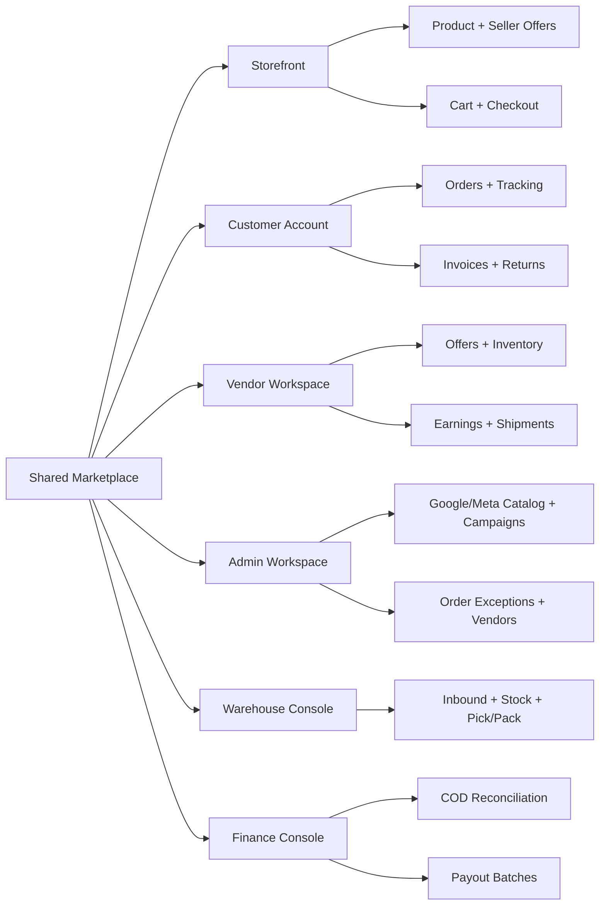

# Sitemap, Navigation and Authorization

## Route map

| Persona | Nav group | Proposed Next.js route |
|---|---|---|
| Customer | Home/products | `/`, `/products/[slug]`, `/products/[slug]/offers` |
| Customer | Checkout/orders | `/cart`, `/checkout`, `/account/orders`, `/account/orders/[id]` |
| Customer | Returns/support | `/account/returns`, `/account/disputes`, `/account/messages` |
| Customer | Invoices | `/account/orders/[id]/invoices` |
| Vendor | Dashboard/earnings | `/vendor`, `/vendor/earnings`, `/vendor/payouts` |
| Vendor | Offers/stock | `/vendor/offers`, `/vendor/inventory`, `/vendor/inbound-transfers` |
| Vendor | Orders/shipments | `/vendor/orders`, `/vendor/orders/[id]`, `/vendor/shipments` |
| Vendor | Promotions | `/vendor/promotions` (vendor-funded *discount*, not vendor advertising) |
| Admin | Operations | `/admin/orders/exceptions`, `/admin/vendors`, `/admin/warehouses` |
| Admin | Tax/docs | `/admin/tax`, `/admin/invoices` |
| Admin | Ads/catalog | `/admin/marketing/catalog`, `/admin/marketing/campaigns` |
| Warehouse | Receive/stock | `/warehouse/receiving`, `/warehouse/stock`, `/warehouse/transfers` |
| Warehouse | Fulfill | `/warehouse/picking`, `/warehouse/packing`, `/warehouse/dispatch` |
| Finance | COD | `/finance/cod/collections`, `/finance/cod/reconciliation` |
| Finance | Payout | `/finance/settlements`, `/finance/payouts`, `/finance/payouts/[id]` |
| Admin | Recommendations | `/admin/recommendations` |

## Nav design
- **Customer**: browse/search primary; cart and account accessible on mobile bottom sheet/top bar.
- **Vendor**: Sales, Orders, Offers, Stock, Promotions, Earnings, Payouts, Support.
- **Warehouse**: Today, Inbound, Stock, Pick, Pack, Dispatch, Transfer, Exceptions.
- **Finance**: Balances, COD, Settlements, Payouts, Adjustments, Reports.
- **Admin**: Dashboard, Catalog, Vendors, Orders, Fulfillment, Marketing, Finance, Tax, Support, Policies, Audit.

## Security
Route gates prevent navigation but do not replace API authorization. Guard every row/object operation against authenticated vendor membership, assigned warehouse, customer ownership, or admin permission. Never expose full buyer private data in aggregate dashboards.
