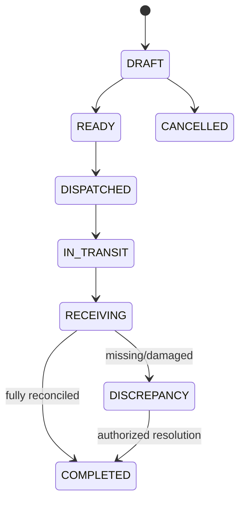

# Module 01 — Multi-Warehouse Operations

## Screens / UX
[[03-Screens/Warehouse-Flows|Warehouse workbench]], [[03-Screens/Vendor-Flows|Vendor inbound]], [[03-Screens/Admin-Flows|Admin warehouse policies]]. Status chips `INBOUND_PENDING`, `IN_TRANSIT`, `RECEIVING`, `AVAILABLE`, `RESERVED`, `QUARANTINED`, `DAMAGED`, `LOST`.

## Entities (PostgreSQL `fulfillment` schema)

| Entity | Key attributes | Integrity rule |
|---|---|---|
| `warehouses` | id, code, name, address, timezone, active | unique(code) |
| `storage_locations` | id, warehouse_id, code, type | unique(warehouse_id, code) |
| `inventory_lots` | id, vendor_id, seller_offer_id, ownership_type, condition | `owner` independent of `custodian` |
| `stock_balances` | id, location_id, inventory_lot_id, on_hand, reserved, version | unique(location_id, lot_id), quantities >=0, reserved<=on_hand |
| `stock_movements` | id, lot_id, from_location_id?, to_location_id?, quantity, type, ref_id, actor_id, occurred_at | immutable; unique business operation key |
| `stock_reservations` | id, order_item_id, lot_id, location_id, quantity, status, expires_at | one active reservation allocation per item+lot+location |
| `stock_transfers` | id, source_type, source_id, target_warehouse_id, status, tracking_ref | typed state transitions |
| `transfer_lines` | id, transfer_id, lot_id, expected_qty, dispatched_qty, received_qty, rejected_qty | no received > dispatched without discrepancy |
| `goods_receipts` | id, transfer_id, receiver_id, status, scanned_at | append receipt lines |
| `serialized_units` | id, lot_id, serial_hash/serial, condition, location_id | unique serial within scope; privacy/security controls |

## State transitions

## API contracts
- `GET /api/v1/warehouses?active=true` — customer-visible locations only when relevant, staff-only full inventory details.
- `POST /api/v1/warehouse/inbound-transfers` — vendor inventory, target warehouse, quantities, client idempotency key; return reference.
- `POST /api/v1/warehouse/transfers/:id/dispatch` — warehouse/vendor dispatch actor with source stock validation.
- `POST /api/v1/warehouse/transfers/:id/receipts` — scans accepted/quarantined/rejected; transaction + discrepancy event.
- `POST /api/v1/warehouse/reservations` — **internal service** call under order transaction; do not expose user-facing stock override.
- `GET /api/v1/warehouse/stock?warehouseId=&offerId=&cursor=` — strict warehouse scope and cursor pagination.

## Domain events
`StockReserved`, `StockReservationReleased`, `InboundDispatched`, `GoodsReceived`, `StockAdjusted`, `StockBecameAvailable`, `InventoryDiscrepancyOpened`.

## Critical algorithms
For allocation, lock candidate stock balance rows in a predictable order, check available stock and update reserved quantities inside the same PostgreSQL transaction. Record reservation expiration. Transit stock is excluded from sellable stock. Cross-warehouse transfers are not one logical instant move; record leaving source, transit, then destination acceptance with discrepancy handling.

## Permission / failure rules
Vendor sees only own lots, not other vendors in the same bin. Warehouse operator accesses only assigned warehouses. Warehouse manager may adjust inventory with reason and audit. Retry scanned receive with idempotency; mismatched serial triggers discrepancy. No silent correction to actual quantity.

## Acceptance
- [ ] Two checkouts competing for one unit yield one successful reservation.
- [ ] Transit quantities not double-counted.
- [ ] Duplicate receipt request doesn't double-add stock.
- [ ] Cross-vendor stock isolation holds on every query/export.
- [ ] Quarantined units never appear in product availability.
- [ ] Audit trail shows who changed stock and why.
