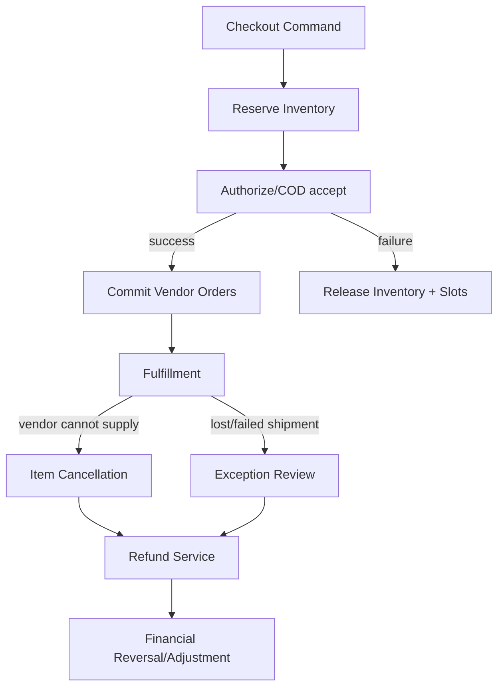

# Module 03 — Order Cancellation and Failure Recovery

## Screens
[[03-Screens/Customer-Flows|Customer cancel and return request]], [[03-Screens/Vendor-Flows|Vendor order detail]], [[03-Screens/Admin-Flows|Exception console]]. Display clear item-level amounts and reason code, not just parent-order status.

## Entities (`commerce` schema)
`order_events(id,order_id,vendor_order_id?,actor_id?,event_type,metadata,occurred_at)`, `cancellation_requests(id,order_id,requested_by,status,reason,created_at)`, `cancellation_lines(id,request_id,order_item_id,qty,refund_estimate_minor)`, `failure_cases(id,order_id,shipment_id?,failure_code,status,opened_at)`, `recovery_actions(id,case_id,action_type,state,attempt_count,idempotency_key)`, `compensation_actions(id,recovery_id,target_domain,reference,status)`.

## Status separation
Order state, payment state, shipment state, return state and vendor payout state are **different** state machines. A parent order can be `PARTIALLY_CANCELLED` with unaffected vendor orders still active.

## API
`POST /api/v1/orders/:id/cancellation-requests`, `GET /api/v1/orders/:id/events`, `POST /api/v1/vendor/orders/:id/reject`, `GET /api/v1/admin/failure-cases`, `POST /api/v1/admin/failure-cases/:id/resolve`.

## Invariants
- No more cancellation/refund quantity than eligible unfulfilled unrefunded quantity.
- Pending payment timeout doesn't unconditionally imply failure; reconcile with gateway first.
- Every compensation carries the original business idempotency key and links to a ledger transaction.
- User-requested cancellation after dispatch enters an eligibility/return workflow; don't silently cancel courier.
- Failed warehouse receiving may reallocate or cancel, with traceable stock movement and customer message.

## Required UI behavior
Show `Cancellation requested`, `Under review`, `Accepted`, `Rejected`, `Refund pending`, `Refund completed`. Explain last cancelable stage and possible effects on delivery/delivery charges. Admin actions show preview before commit; financial reversal uses refund service.

## Acceptance
- [ ] One failed vendor sub-order doesn't cancel unaffected vendors.
- [ ] Duplicate cancellation request doesn't issue double refund.
- [ ] Payment callback arriving late reconciles with pending order.
- [ ] Refund and delivery allocation reversal respect partial quantity.
- [ ] User sees accurate per-item status and appeal route.
