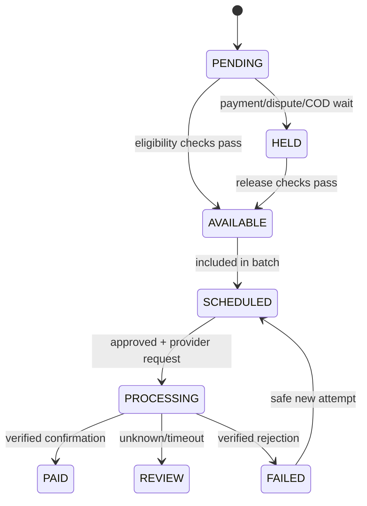

# Module 04 — Vendor Settlements and Payouts

## Agreed financial rule
For each sold order item: 10% commission on final price **after vendor discount**. Vendor portion is 90% **before allocated platform delivery**. Vendor pays no advertising fee. Refunds, tax handling and adjustments are posted separately, not hidden in the selling price.

## Screens
[[03-Screens/Vendor-Flows|Vendor earnings]], [[03-Screens/Finance-and-Support|Finance payout dashboard]] and audit drawer. Show `SALE`, `COMMISSION`, `PLATFORM_DELIVERY_DEDUCTION`, `REFUND`, `REVERSAL`, `PAYOUT`, `ADJUSTMENT` as distinct ledger categories.

## Entities (`finance` schema)
- `ledger_accounts(id,owner_type,owner_id,currency,account_type)`.
- `ledger_transactions(id,type,reference_type,reference_id,idempotency_key,posted_at)`.
- `ledger_entries(id,transaction_id,account_id,side,amount_minor,currency)`.
- `vendor_settlements(id,vendor_order_id,vendor_id,currency,status,eligible_at,hold_reason,version)`.
- `settlement_items(id,settlement_id,source_ref,kind,amount_minor)`.
- `payout_batches(id,currency,status,created_by,approved_by?,created_at)`.
- `payouts(id,batch_id,vendor_id,payout_method_ref,amount_minor,status,provider_reference?)`.
- `payout_attempts(id,payout_id,attempt_key,external_ref?,state,created_at)`.
- `payout_reconciliation(id,payout_id,statement_ref,matched_amount,status)`.

## State machine

## API / guards
`GET /api/v1/vendor/earnings`, `GET /api/v1/vendor/payouts`, `GET /api/v1/vendor/payouts/:id/statement`, `GET /api/v1/finance/payout-batches`, `POST /api/v1/finance/payout-batches`, `POST /api/v1/finance/payout-batches/:id/approve`, `POST /api/v1/finance/payouts/:id/reconcile`.

`VENDOR_FINANCE_READ` scoped to vendor. `FINANCE_MAKER` creates. `FINANCE_APPROVER` is **different actor** from maker for live payout. Bank account changes require verification/audit.

## Accounting invariants
All journal transactions balance by currency. No update/delete to posted ledger entries; corrections through reversals. Payout amount cannot exceed cleared vendor liability. On provider timeout, first **query status by provider reference** rather than blindly sending another transfer. COD order cannot be released until legitimate collection/remittance condition passes. Refund after paid creates new recovery receivable/negative balance case with configured policy.

## Acceptance
- [ ] ¥1,000 sale creates ¥100 gross commission and ¥900 vendor share before delivery.
- [ ] ¥150 platform fulfillment delivery allocation yields ¥750 vendor payable under illustrated assumptions.
- [ ] Vendor fulfilled order has no platform delivery deduction.
- [ ] Duplicated `OrderDelivered`/`CODRemitted` events cannot pay twice.
- [ ] Maker/approver separation enforced.
- [ ] Provider timeout gets `REVIEW`, not automatic duplicate transfer.
