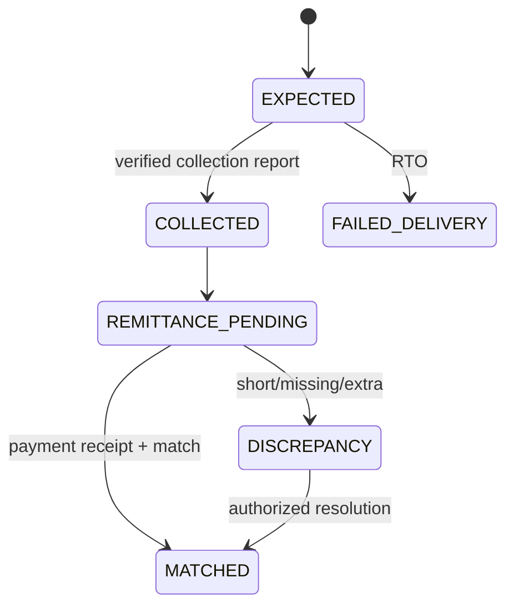

# Module 06 — COD Settlement and Reconciliation

## Core distinction
`DELIVERED` ≠ `CASH_COLLECTED` ≠ `CASH_REMITTED` ≠ `MATCHED` ≠ `VENDOR_PAYABLE`. The platform must track each event separately.

## Screens
[[03-Screens/Finance-and-Support|COD reconciliation console]]: daily carrier batch list, expected/collected/remitted/difference, unmatched rows, evidence, reconciliation actions and held settlements.

## Entities (`payments`)
- `cod_collections(id,order_id,shipment_id,carrier_id,expected_minor,collected_minor?,currency,status,provider_ref?,collected_at?)`.
- `cod_collection_events(id,collection_id,carrier_event_ref,payload_hash,event_type,occurred_at)`.
- `cod_remittance_batches(id,carrier_id,batch_ref,currency,reported_total_minor,bank_receipt_asset_id?,status)`.
- `cod_remittance_lines(id,batch_id,tracking_ref,order_id?,amount_minor,external_line_id?)`.
- `cod_reconciliations(id,collection_id,remittance_line_id,matched_minor,status,reviewer_id?)`.
- `cod_discrepancies(id,collection_id?,batch_id,kind,expected_minor,observed_minor,status,reason)`.

## State transitions

## API
`POST /api/v1/webhooks/carriers/:provider` (verified and replay protected), `POST /api/v1/finance/cod/remittances/import`, `POST /api/v1/finance/cod/reconcile`, `GET /api/v1/finance/cod/discrepancies?cursor=`, `POST /api/v1/finance/cod/discrepancies/:id/resolve`.

## Workflow
Courier submits collection proof → verified event recorded once → remittance batch imported and linked to bank receipt → match by trusted carrier ref/tracking/order/amount → partial/missing/excess create exception → finance resolves with evidence → settlement availability event emitted.

## Vendor fulfilled COD
Shipping and COD collection are separate concerns. If vendor courier collects cash, require contractually defined remittance to platform (or alternative authorized remittance arrangement) so platform commission is recoverable. **Policy is OPEN**, do not default to assuming platform has the cash.

## Acceptance
- [ ] Duplicate courier events have no duplicate cash posting.
- [ ] Delivered but unremitted order remains payout-held.
- [ ] Short remittance produces discrepancy, not false match.
- [ ] Overpayment cannot be silently allocated to unrelated order.
- [ ] Every reconciliation decision is auditable.
