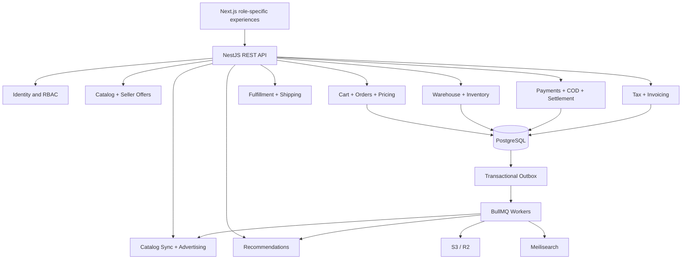

# Architecture and Module Interfaces

## Runtime
Next.js customer, vendor, admin, warehouse and finance apps (may be deployed as separate frontends or role-routed apps) call a NestJS modular monolith. PostgreSQL is source of truth. Redis/BullMQ provide ephemeral queue/worker support. R2/S3 stores immutable invoice PDFs, manifests, labels, images and evidence. Meilisearch indexes eligible product/offer records, never payment source of truth.

## Source-of-truth and module ownership

| Module | Writes its own | Reads via |
|---|---|---|
| Catalog | canonical products, seller offers, vendor discounts | vendor authorization service, inventory availability projection |
| Commerce | carts, parent/vendor orders, price snapshots | pricing, tax quote, stock reservation, payment |
| Inventory | stock balances, reservations, transfers, receipts | catalog SKU/offer, vendor/warehouse identity |
| Fulfillment | fulfillments, packages, shipment legs, carrier costs | orders and inventory |
| Payments/COD | payment, COD evidence, remittance | vendor orders and shipments |
| Finance | posted ledger, settlements, payout batches | payment/COD status, vendor authorization |
| Tax | immutable tax calculations, invoices/credit notes | finalized orders and legal entity policy |
| Recommendations | signals, candidates and impressions | catalog eligible offer read model |
| Advertising | feed sync and campaign state | catalog, promotions, pricing, inventory |

Avoid controllers writing into other modules' tables ad hoc. Prefer injected use-case services for strongly consistent operations and durable event contracts for asynchronous projections.

## Authorization strategy
Session-based auth or OIDC with secure cookies, CSRF controls where applicable, MFA for privileged actors. RBAC PLUS resource/relationship policy checks (`vendorMembership`, `warehouseAssignment`, `orderOwnership`, `financeRole`). Every database read/export uses scoped repository methods.

## Transaction boundaries
- Checkout: quote validation, stock/slot reservation, order and payment intent sequencing with idempotency.
- Warehouse receive: receipt and inventory movement in one DB transaction.
- Shipping allocation finalization: exact allocation and finance event recorded atomically.
- Ledger post: debit/credit entries, balancing verification and unique idempotency key in one DB transaction.
- Payment to external network cannot be one cross-system ACID transaction: use durable intent, verified callbacks, explicit compensation/reconciliation.

## Deployment / resilience
Stateless API nodes, managed PostgreSQL with PITR backup, Redis durable queue configuration and a worker deployment. CDN for media; secret manager for gateway/Google/Meta keys. Observability: correlation IDs, structured logs, trace spans, queue lag, unreconciled money, stock discrepancies, feed rejection, and batch payout alerts. Test restore regularly.
