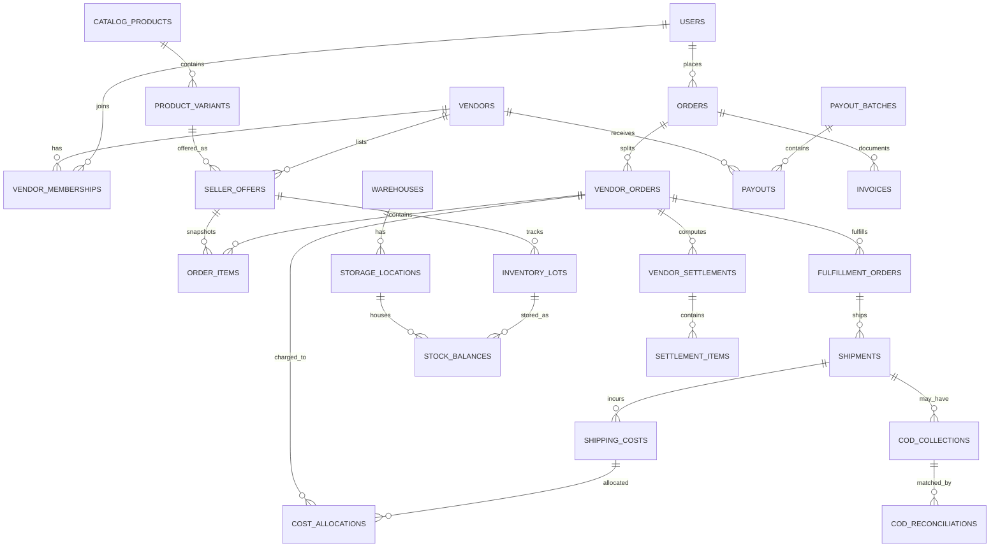

# PostgreSQL Logical ERD and Schema Migration Plan

> [!important] Proposed model
> Reference schema only; no existing repository/database inspected. Migration names must be reconciled with actual project before execution.

## Relationships



## Canonical keys and monetary conventions
- UUID primary keys (`gen_random_uuid()`), UTC `TIMESTAMPTZ`, explicit IANA timezone per warehouse/promotion.
- `amount_minor BIGINT` plus ISO 4217 currency. JPY has 0 fractional minor places; other currencies vary.
- Fixed commission `commission_rate_bps=1000` snapshotted per item with a *versioned rounding policy*.
- Store original price, vendor discount, final item price, commission, platform delivery cost allocation and vendor payable as derived immutable transaction snapshots, not mutable single fields without ledger.
- Unique seller offer SKU within vendor; catalog product and variant separate from seller offer. Allow multiple vendor offers per variant.

## Migration packages in dependency order

| Migration family | Main objects | Prerequisite |
|---|---|---|
| M001 | identity, vendor memberships, role grants | none |
| M002 | catalog products, variants, seller offers and constraints | M001 |
| M003 | commerce orders, vendor orders, items, price snapshot | M001–M002 |
| M004 | inventory warehouse, bins, lots, balances and movements | M001–M003 |
| M005 | fulfillment orders, shipment legs and allocations | M003–M004 |
| M006 | payment, COD evidence and remittance | M003–M005 |
| M007 | finance ledger, settlements, payout batches | M003, M005–M006 |
| M008 | tax rules, calculations, invoice/credit notes | M003, M007 |
| M009 | outbox, inbox, audit logs, idempotency keys | include primitives earlier where needed |
| M010 | ads/catalog sync, recommendations, experience extensions | M002–M009 |

## Sample DDL — stock reservation (simplified)

```sql
CREATE SCHEMA IF NOT EXISTS fulfillment;
CREATE TABLE fulfillment.stock_balances (
  id UUID PRIMARY KEY DEFAULT gen_random_uuid(),
  location_id UUID NOT NULL,
  inventory_lot_id UUID NOT NULL,
  on_hand_qty INTEGER NOT NULL CHECK (on_hand_qty >= 0),
  reserved_qty INTEGER NOT NULL DEFAULT 0 CHECK (reserved_qty >= 0),
  version INTEGER NOT NULL DEFAULT 1,
  UNIQUE (location_id, inventory_lot_id),
  CHECK (reserved_qty <= on_hand_qty)
);
-- Add FK constraints after warehouse and inventory_lot tables exist.
-- This DDL is illustrative, not a complete migration.
```

## Index strategy
`vendor_orders(vendor_id,status,created_at DESC,id DESC)`; `stock_balances(location_id,inventory_lot_id)` unique; `stock_reservations(order_item_id,status)`; `cod_collections(carrier_id,status,created_at)`; `payouts(vendor_id,status,created_at)`; `shipping_cost_allocations(shipping_cost_id,vendor_order_id)` unique; `advertising.catalog_items(provider,offer_id)` unique; outbox `(state,next_attempt_at)`.

## Data lifecycle and audit
Invoice PDFs, carrier receipts, dispute evidence in object storage with checksum and restricted access. PII minimizing: do not put emails/addresses into logs. Implement retention policy per market. Append-only audit and ledger; deletion strategy must preserve mandatory accounting records lawfully.

> [!note] Pending schema review
> This is a reference model, not an approved migration set. [[09-Implementation/Architecture-Audit]]
> records 24 missing objects and recommends moving outbox/inbox/idempotency/audit primitives
> into M001 because every later module depends on them. [[09-Implementation/Dependency-Graph]]
> shows the resulting dependency order. Do not execute these migrations before Gate 0.
