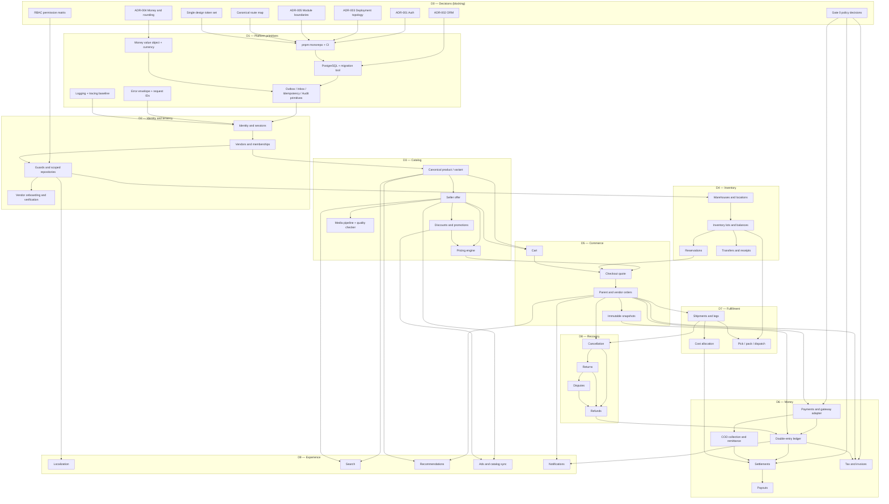
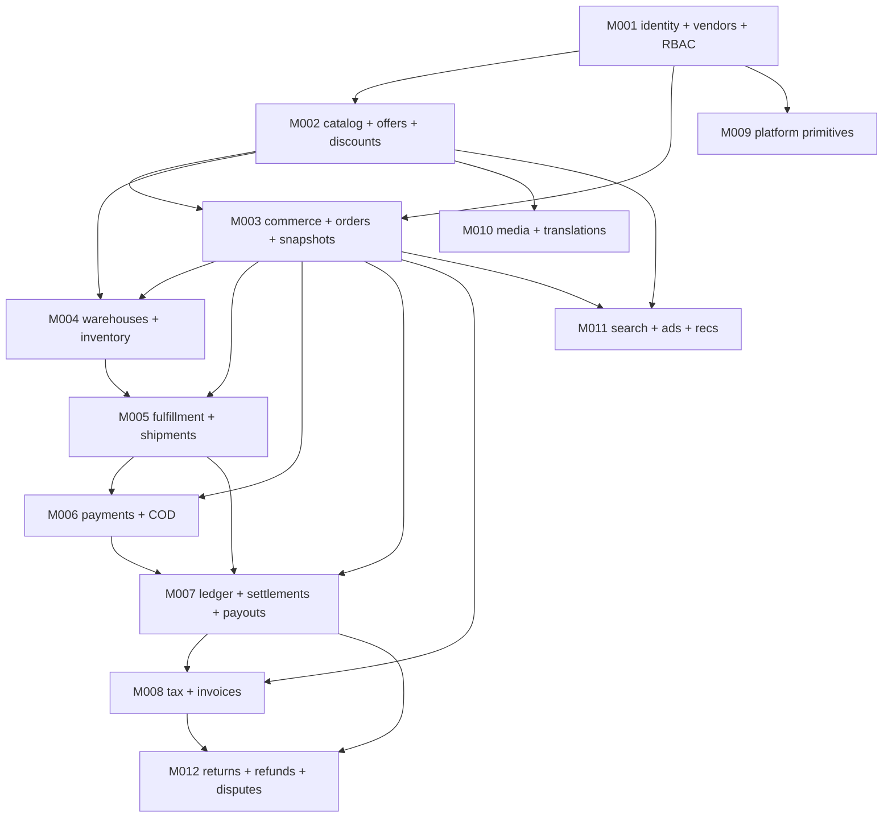
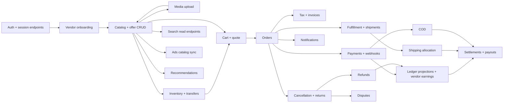
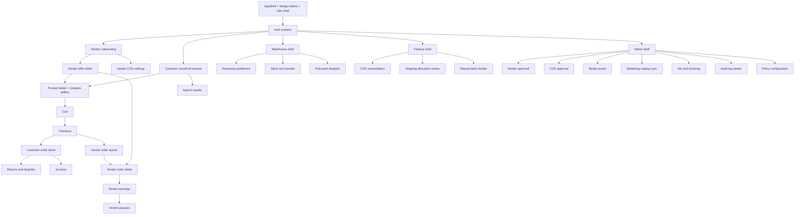

# Dependency Graph — Build Order

> [!note] Planning artifact
> This graph expresses **design-time build dependencies**, not deployed infrastructure.
> An edge `A --> B` means **B cannot be completed correctly before A is stable**.
> No code exists. See [[09-Implementation/Architecture-Audit]] for the gaps this graph resolves.

## Related documents
- [[00-START-HERE]]
- [[01-Product/Business-Rules]]
- [[01-Product/Decision-Register]]
- [[05-Architecture/Architecture-and-Interfaces]]
- [[05-Architecture/Data-Model]]
- [[05-Architecture/API-Contracts]]
- [[05-Architecture/Events-and-Failures]]
- [[06-Implementation/Backlog]]
- [[09-Implementation/Milestones]]
- [[09-Implementation/Task-Backlog]]
- [[09-Implementation/Readiness-Checklist]]

---

## 1. Foundation dependency graph

---

## 2. Critical path

The longest blocking chain determines the earliest possible launch:

```mermaid
flowchart LR
  A[ADRs + policy] --> B[Monorepo + primitives]
  B --> C[Identity + RBAC]
  C --> D[Catalog + offers]
  D --> E[Inventory + reservations]
  E --> F[Cart + quote + orders]
  F --> G[Payments + ledger]
  G --> H[Settlements + payouts]
  H --> I[COD + tax + invoices]
  I --> J[Fulfillment + allocation]
  J --> K[Returns + refunds + disputes]
  K --> L[Search + i18n + notifications]
  L --> M[Ads + recommendations]
  M --> N[Release gates]
```

**Critical path length:** 14 stages. Parallelizable branches (media, search, notifications, recommendations, ads) do not shorten it because they depend on catalog or orders.

**Earliest safe launch:** after stage K plus release-gate verification. Advertising and recommendations (L–M) may ship post-launch if catalog sync eligibility is stable.

---

## 3. Module dependency matrix

Rows depend on columns. `—` means no direct dependency.

| Module | Identity | Vendor | Catalog | Inventory | Commerce | Payments | Ledger | Fulfillment | Tax | Search | Ads | Recs | Notif |
|---|---|---|---|---|---|---|---|---|---|---|---|---|---|
| Identity | — | — | — | — | — | — | — | — | — | — | — | — | — |
| Vendor | ✔ | — | — | — | — | — | — | — | — | — | — | — | — |
| Catalog | ✔ | ✔ | — | — | — | — | — | — | — | — | — | — | — |
| Inventory | ✔ | ✔ | ✔ | — | — | — | — | — | — | — | — | — | — |
| Commerce | ✔ | ✔ | ✔ | ✔ | — | — | — | — | — | — | — | — | — |
| Payments | ✔ | — | — | — | ✔ | — | — | — | — | — | — | — | — |
| Ledger | ✔ | ✔ | — | — | ✔ | ✔ | — | — | — | — | — | — | — |
| Fulfillment | ✔ | ✔ | ✔ | ✔ | ✔ | — | — | — | — | — | — | — | — |
| Tax | ✔ | ✔ | ✔ | — | ✔ | — | ✔ | — | — | — | — | — | — |
| Search | — | ✔ | ✔ | ✔ | — | — | — | — | — | — | — | — | — |
| Ads | — | ✔ | ✔ | ✔ | — | — | — | — | — | — | — | — | — |
| Recs | ✔ | ✔ | ✔ | ✔ | ✔ | — | — | — | — | — | — | — | — |
| Notifications | ✔ | ✔ | — | — | ✔ | ✔ | ✔ | ✔ | ✔ | — | — | — | — |

**Rules enforced by this matrix:**
- No module may import another module's tables directly; use its service or a read model.
- `Ledger` is the only writer of financial entries.
- `Commerce` never writes inventory; it calls `Inventory` reservation services.
- `Ads`, `Search`, `Recs` are read-only projections of catalog and commerce.

---

## 4. Data migration dependency order

> [!warning] Correction to [[05-Architecture/Data-Model]]
> The original plan places outbox/inbox/audit/idempotency in **M009**, after finance.
> Every module from M001 onward needs them. This graph moves the **primitives** into M001
> (as tables) and keeps only the **dispatcher/worker wiring** in M009.
> This is a recommendation, not an applied change. Record it in the ADR log.

---

## 5. API dependency order

**Contract-first rule:** publish OpenAPI schema + shared Zod contract before the corresponding UI task starts. UI tasks that depend on an unpublished contract are blocked.

---

## 6. UI dependency order

---

## 7. Test dependency order

| Layer | Depends on | Required before |
|---|---|---|
| Money unit tests (rounding, allocation) | Money value object | Any financial module |
| RBAC matrix tests | Permission matrix | Any guarded endpoint |
| Repository isolation tests | Scoped repositories | Any vendor/customer endpoint |
| Concurrency tests (stock, idempotency) | Inventory + primitives | Checkout |
| Ledger invariant tests | Ledger | Settlement |
| Contract tests (OpenAPI) | Published contracts | UI integration |
| E2E happy path | Checkout + payment sandbox | Gate 2 |
| E2E failure path (timeout, duplicate webhook) | Payments + outbox | Gate 2 |
| Accessibility tests | UI shell | Every screen task |
| Load tests | Stable API + seed data | Gate 4 |

---

## 8. Blocking dependency register

| Blocker | Blocks | Owner decision needed |
|---|---|---|
| ADR-001 Auth | Identity, all guarded APIs, all UI | Architecture |
| ADR-002 ORM | Migrations, repositories | Architecture |
| ADR-003 Topology | Monorepo layout, CI, cookies | Architecture |
| ADR-004 Money/rounding | Ledger, settlement, invoices | Finance + Architecture |
| ADR-005 Module boundaries | Import rules, lint config — decision prerequisite resolved; implementation still blocked by Gate 0 | RESOLVED: Revision 3 APPROVED by Project Owner, 2026-10-19; M0-T05 DONE; [[06-Implementation/PROGRESS-LOG#M0-T05 approval evidence]] |
| RBAC matrix | Guards, UI gates, tests | Product + Security |
| Canonical routes | Frontend scaffold, auth scopes | Product + UX |
| Design tokens | UI shell | Design |
| BR-07 returns window | Settlement eligibility | Business |
| BR-09 COD remittance | COD module, vendor COD | Business + Legal |
| BR-10 country / seller-of-record | Tax, invoices, gateways | Legal |
| BR-13 tax inclusive/exclusive | Pricing, invoices | Finance + Legal |
| BR-14 rounding | Ledger correctness | Finance |
| BR-15 negative payable | Settlement edge case | Finance |
| BR-16 gateway availability | Payments | Business |

**Unblock rule:** no task in [[09-Implementation/Task-Backlog]] marked `BLOCKED` may start until its listed blocker is resolved **and recorded in [[01-Product/Decision-Register]]**.

## Dependency interpretation and unresolved sequencing

A dependency graph must distinguish **build prerequisites**, **runtime public interface calls**, **event subscriptions**, and **foreign keys**. These are not interchangeable nor permission to import a module’s private repositories. See [[05-Architecture/ADRs/ADR-005-Module-Boundaries]].

Gate 0 explicitly blocks M1 and later implementation until approval. The Codex audit flagged additional sequencing for quote revalidation, COD approval, common offer eligibility, settlements and M12 release sign-off; see [[09-Implementation/Milestone-Reconciliation]]. This appendix documents issues without falsely marking them resolved.

Migration sequence IDs `M001`–`M012` in diagrams are **not** milestone IDs; their conflicting uses in Data-Model and this graph require separate reconciliation before migrations.
