# Implementation Milestones

> [!important] Status
> **No milestone is started.** Every checkbox is unchecked by definition.
> A milestone is complete only when its acceptance criteria are verified by tests and evidence.
> Canonical milestone IDs are M0–M12; previous M00–M14 summaries are mapped in [[09-Implementation/Milestone-Reconciliation]]. Milestones map to the stage gates in [[00-START-HERE]] and expand [[06-Implementation/Backlog]].

## Related documents
- [[00-START-HERE]]
- [[01-Product/Business-Rules]]
- [[01-Product/Decision-Register]]
- [[05-Architecture/Architecture-and-Interfaces]]
- [[05-Architecture/Data-Model]]
- [[05-Architecture/API-Contracts]]
- [[05-Architecture/Events-and-Failures]]
- [[06-Implementation/Backlog]]
- [[09-Implementation/Architecture-Audit]]
- [[09-Implementation/Dependency-Graph]]
- [[09-Implementation/Task-Backlog]]
- [[09-Implementation/Readiness-Checklist]]

---

## 1. Milestone overview

```mermaid
flowchart LR
  M0[M0 Decisions<br/>Gate 0] --> M1[M1 Platform foundation]
  M1 --> M2[M2 Identity and tenancy]
  M2 --> M3[M3 Catalog and media]
  M3 --> M4[M4 Inventory and warehouses]
  M4 --> M5[M5 Cart checkout and orders]
  M5 --> M6[M6 Payments and ledger<br/>Gate 1]
  M6 --> M7[M7 Fulfillment and shipping<br/>Gate 2]
  M7 --> M8[M8 Tax COD settlements payouts<br/>Gate 3]
  M8 --> M9[M9 Returns refunds disputes]
  M9 --> M10[M10 Localization search notifications]
  M10 --> M11[M11 Ads and recommendations<br/>Gate 4]
  M11 --> M12[M12 Hardening and launch]
```

| Milestone | Theme | Gate | Priority | Exit condition |
|---|---|---|---|---|
| M0 | Decisions and architecture records | Gate 0 | P0 | All blockers recorded and resolved |
| M1 | Platform foundation | — | P0 | Monorepo builds, CI green, primitives tested |
| M2 | Identity and tenancy | — | P0 | RBAC enforced on every route |
| M3 | Catalog, offers, media | — | P0 | Vendor can publish an approved offer |
| M4 | Inventory and warehouses | — | P0 | No oversell under concurrency |
| M5 | Cart, checkout, orders | — | P0 | One checkout → parent + vendor orders |
| M6 | Payments and ledger | Gate 1 | P0 | Ledger balances; idempotent webhooks |
| M7 | Fulfillment and shipping | Gate 2 | P0 | Shipment lifecycle + allocation exact |
| M8 | Tax, COD, settlements, payouts | Gate 3 | P0 | Money flow reconciled end-to-end |
| M9 | Returns, refunds, disputes | — | P0 | Partial refunds correct and audited |
| M10 | Localization, search, notifications | — | P1 | en/ja/id with multilingual search |
| M11 | Ads and recommendations | Gate 4 | P2 | Catalog sync verified; recs filtered |
| M12 | Hardening and launch | — | P0 | All release gates pass |

---

## M0 — Decisions and architecture records

**Goal:** remove every blocking ambiguity before code generation.

**Dependencies:** none. **Blocks:** all milestones.

### Deliverables
- [ ] ADR-001 Authentication architecture (session vs OIDC, MFA, guest access).
- [ ] ADR-002 ORM selection (Prisma vs Drizzle) with decision matrix.
- [ ] ADR-003 Deployment topology and app count (finance app vs admin route).
- [ ] ADR-004 Money representation and rounding policy.
- [x] ADR-005 Module boundaries and dependency rules — Revision 3 APPROVED by Project Owner, 2026-10-19; M0-T05 DONE; [[06-Implementation/PROGRESS-LOG#M0-T05 approval evidence]]. All other M0 deliverables remain outstanding; Gate 0 remains NOT READY.
- [ ] RBAC permission matrix (role × permission × scope).
- [ ] Canonical route map (`uuid` vs `id`, `products` vs `offers`).
- [ ] Single design token set (reconcile the two palettes).
- [ ] Gate 0 policy decisions: country, seller-of-record, tax mode, COD remittance, payout cadence, returns window, negative payable, gateway.
- [ ] Performance budgets and capacity targets.

### Acceptance criteria
- [ ] Every `OPEN` item in [[01-Product/Decision-Register]] has a recorded decision or an explicit "deferred with safe default" entry.
- [ ] Every ADR contains context, options, decision, justification, consequences, migration impact.
- [ ] No milestone task references an unresolved blocker.
- [ ] A reviewer can map any future endpoint to a permission and a module boundary.

### Test requirements
- Documentation review only. No code tests.

---

## M1 — Platform foundation

**Goal:** a buildable, deployable skeleton with reliability primitives and money correctness.

**Dependencies:** M0.

### Deliverables
- [ ] pnpm workspace: `apps/{storefront,vendor,admin,warehouse,api,worker}` + `packages/{database,ui,contracts,validation,config}`.
- [ ] TypeScript project references, shared ESLint/Prettier, strict mode.
- [ ] Docker Compose: PostgreSQL, Redis, Meilisearch, MinIO (S3-compatible).
- [ ] Migration tool wired per ADR-002; forward-only migration policy.
- [ ] `Money` value object: integer minor units, currency, rounding policy, arithmetic guards.
- [ ] Platform primitives schema: `outbox`, `inbox`, `idempotency_keys`, `audit_log`.
- [ ] Outbox dispatcher skeleton with claiming, visibility timeout, DLQ.
- [ ] Standard error envelope + request ID middleware + RFC7807 mapping.
- [ ] Structured logging, correlation IDs, OpenTelemetry bootstrap.
- [ ] CI: lint, typecheck, unit tests, migration test, build.
- [ ] Seed script for local development.

### Acceptance criteria
- [ ] `pnpm build`, `pnpm lint`, `pnpm typecheck`, `pnpm test` pass on a clean clone.
- [ ] Outbox row written in the same transaction as a test mutation and dispatched at least once with deduplicated consumer effects.
- [ ] Duplicate `Idempotency-Key` returns the original response, not a second mutation.
- [ ] `Money` rejects mixed currencies and invalid minor units.
- [ ] Migration applies and rolls back in CI (forward-only verified on a scratch DB).

### Test requirements
- Unit: money arithmetic, rounding, error mapping.
- Integration: outbox dispatch, inbox dedupe, idempotency replay.
- Contract: error envelope shape.

---

## M2 — Identity and tenancy

**Goal:** authenticated actors with strict resource isolation.

**Dependencies:** M1.

### Deliverables
- [ ] Users, credentials, sessions, MFA (privileged roles).
- [ ] Customer registration, login, logout, password reset.
- [ ] Vendor onboarding, verification documents, approval state machine.
- [ ] Vendor memberships with roles (`VENDOR_OWNER`, `VENDOR_STAFF`).
- [ ] Warehouse staff assignment to warehouses.
- [ ] Finance roles with maker/checker separation.
- [ ] Permission guards + scoped repository pattern.
- [ ] Audit log on every privileged action.
- [ ] Rate limiting on auth endpoints.
- [ ] Guest checkout identity model + secure order access token (per ADR-001).

### Acceptance criteria
- [ ] A vendor member cannot read another vendor's resource by ID (API test).
- [ ] A customer cannot read another customer's order by UUID (API test).
- [ ] Guest order access requires verified token; bare UUID returns 404/403 (API test).
- [ ] Admin routes require MFA; non-MFA session is rejected.
- [ ] Every guarded endpoint has a matrix entry and a passing authorization test.
- [ ] Privilege changes are audited with actor, before, after.

### Test requirements
- Unit: permission evaluator, scope predicates.
- Integration: session lifecycle, MFA, rate limits.
- Security: horizontal and vertical privilege escalation matrix.

---

## M3 — Catalog, offers, discounts, media

**Goal:** vendors can create canonical products, offers, discounts, and compliant images.

**Dependencies:** M2.

### Deliverables
- [ ] Categories, brands, attributes, canonical products, variants.
- [ ] Seller offers with SKU, condition, price, stock source, fulfillment method, COD flag.
- [ ] Discount schedules with start/end in IANA timezone and vendor funding.
- [ ] Pricing engine: authoritative effective price, validation, expiry.
- [ ] Media: signed upload intent, completion, validation, AV scan, Sharp variants, CDN URLs.
- [ ] Image quality checker: objective checks, perceptual hash duplicates, statuses, admin review.
- [ ] Offer approval workflow (admin).
- [ ] Vendor offer editor UI + admin media review UI.
- [ ] Catalog search index projection (write path only; read in M10).

### Acceptance criteria
- [ ] Discount cannot start in the past retroactively; expired discount stops applying at the boundary instant.
- [ ] Commission basis uses the final discounted price (verified in a pricing test).
- [ ] Vendor A cannot modify Vendor B's offer or images (API test).
- [ ] Invalid image never reaches a public URL; failed conversion leaves no broken reference.
- [ ] Offer approval state gates storefront visibility and catalog sync eligibility.
- [ ] Price change emits an event that will drive search/ads projections.

### Test requirements
- Unit: pricing rules, discount boundary conditions, quality thresholds.
- Integration: upload → scan → variants → public URL; approval transitions.
- E2E: vendor creates offer and sees it approved (admin flow).

---

## M4 — Inventory and warehouses

**Goal:** correct, isolated, concurrency-safe stock.

**Dependencies:** M3.

### Deliverables
- [ ] Warehouses, storage locations, custody vs ownership model.
- [ ] Inventory lots, stock balances, immutable stock movements.
- [ ] Reservations with expiry and release job.
- [ ] Transfers: create, dispatch, in-transit, receive, discrepancy.
- [ ] Serialized units where required.
- [ ] Stock adjustment with reason + manager approval + audit.
- [ ] Availability projection for catalog/checkout.
- [ ] Warehouse receiving UI and stock/transfer UI.

### Acceptance criteria
- [ ] Two concurrent checkouts for one unit: exactly one reservation succeeds.
- [ ] Transit stock is excluded from sellable availability.
- [ ] Duplicate receipt request does not double-add stock.
- [ ] Quarantined/damaged units never appear as available.
- [ ] Cross-vendor stock isolation holds on list, detail, and export.
- [ ] Every adjustment has actor, reason, before/after, and correlation ID.

### Test requirements
- Concurrency: parallel reservation, row lock ordering.
- Integration: transfer lifecycle, discrepancy, reservation expiry.
- Property test: `on_hand = available + reserved + quarantined + in_transit` per location/lot.

---

## M5 — Cart, checkout, orders

**Goal:** one cart and one checkout producing a correct multi-vendor order.

**Dependencies:** M4.

### Deliverables
- [ ] Server cart with guest token, expiry, merge-on-login.
- [ ] Checkout quote: price, tax placeholder, shipping placeholder, COD eligibility, immutable snapshot.
- [ ] Quote revalidation before commit (price, stock, offer status, COD).
- [ ] Parent order + vendor orders + order items + snapshots.
- [ ] Human-readable order numbers separate from UUID routes.
- [ ] Order state machines separated: order, payment, shipment, return, payout.
- [ ] Customer checkout UI (3–4 steps) + order detail UI.
- [ ] Guest checkout UI with verification.
- [ ] Idempotent `place order` command.

### Acceptance criteria
- [ ] One checkout with three vendors creates one parent order and three vendor orders.
- [ ] Duplicate place-order request with the same idempotency key creates no duplicate order.
- [ ] Price or stock change between quote and commit is surfaced, not silently accepted.
- [ ] COD option appears only when every participating offer, vendor, destination, and carrier is eligible.
- [ ] Mixed online-only cart forces online payment with an explanation.
- [ ] Historical order price is unaffected by later offer price changes.
- [ ] Guest cannot access another guest's order.

### Test requirements
- Unit: cart totals, quote snapshot, eligibility predicates.
- Integration: quote → order transaction, idempotency, split logic.
- E2E: multi-vendor checkout (online + COD paths).
- Security: cross-customer and cross-guest access.

---

## M6 — Payments and ledger (Gate 1)

**Goal:** centralized payment accounting with an immutable double-entry ledger.

**Dependencies:** M5.

### Deliverables
- [ ] Payment provider adapter interface + sandbox integration.
- [ ] Payment intents, authorization, capture, void, refund primitives.
- [ ] Verified webhooks with inbox dedupe and replay protection.
- [ ] Chart of accounts: sales, commission, delivery, refunds, receivables, payouts, tax payable.
- [ ] Ledger transactions + balanced entries with idempotency keys.
- [ ] Payment allocation per vendor order.
- [ ] Commission calculation with versioned rounding policy and per-item snapshot.
- [ ] Refund and reversal posting.
- [ ] Reconciliation job for unknown provider states.

### Acceptance criteria
- [ ] Every ledger transaction balances to zero by currency.
- [ ] ¥1,000 final item → ¥100 commission → ¥900 vendor share before delivery (exact test).
- [ ] Duplicate webhook does not double-post.
- [ ] Provider timeout results in `REVIEW`, not a duplicate charge or transfer.
- [ ] Commission is computed on post-discount price, never pre-discount.
- [ ] Ledger entries are append-only; no update/delete path exists.

### Test requirements
- Unit: commission, rounding, chart-of-accounts posting.
- Integration: webhook dedupe, reconciliation, transaction rollback.
- Property test: sum of debits = sum of credits per transaction.
- Security: webhook signature rejection.

**Gate 1 exit:** ledger, orders, money snapshots, and idempotency verified end-to-end.

---

## M7 — Fulfillment and shipping (Gate 2)

**Goal:** independent fulfillment per vendor with exact cost allocation.

**Dependencies:** M6.

### Deliverables
- [ ] Fulfillment orders, packages, shipment legs.
- [ ] Carrier registry, service selection, labels, tracking.
- [ ] Pick / pack / dispatch workflow with scanning.
- [ ] Shipping quotes and actual carrier costs.
- [ ] Allocation engine with versioned method and deterministic remainder.
- [ ] Shipping adjustments (never overwrite historical allocation).
- [ ] Warehouse operational UI (receiving, stock, pick/pack/dispatch).
- [ ] Customer tracking timeline.
- [ ] Status recovery for lost/failed shipments.

### Acceptance criteria
- [ ] Vendor-fulfilled shipment has zero platform delivery deduction.
- [ ] Platform-fulfilled shipment deducts the allocated platform cost only.
- [ ] Two-vendor shared shipment with ¥300 actual cost allocates exactly ¥300.
- [ ] Late carrier invoice produces an adjustment, not a replacement.
- [ ] Customer sees per-package tracking; vendor sees only its own shipments.
- [ ] Dispatch cannot occur without stock reservation.

### Test requirements
- Unit: allocation remainder distribution, currency mismatch blocking.
- Integration: label → dispatch → delivered; late invoice adjustment.
- Concurrency: pick/pack against reserved stock.
- E2E: platform-fulfilled and vendor-fulfilled journeys.

**Gate 2 exit:** warehouse + shipping + status recovery tested.

---

## M8 — Tax, COD, settlements, payouts (Gate 3)

**Goal:** lawful money out, reconciled and dual-controlled.

**Dependencies:** M7.

### Deliverables
- [ ] Tax jurisdictions, rate versions, registrations, tax calculations.
- [ ] Invoice issuance, immutable PDFs in object storage, credit notes.
- [ ] COD collections, carrier events, remittance batches, reconciliation, discrepancies.
- [ ] Vendor COD approval workflow and per-offer toggles.
- [ ] Vendor settlements with eligibility, holds, and item breakdown.
- [ ] Payout batches, maker-checker, provider transfer, reconciliation, statements.
- [ ] Negative balance handling per policy.
- [ ] Finance UI: COD reconciliation, allocation review, payout builder.
- [ ] Admin UI: COD approval, tax configuration, invoice manager.

### Acceptance criteria
- [ ] COD delivered but unremitted remains payout-held.
- [ ] Short remittance creates a discrepancy, never a false match.
- [ ] Payout cannot exceed cleared vendor liability.
- [ ] Maker and approver are different actors (DB-enforced).
- [ ] Provider timeout → `REVIEW`; no automatic second transfer.
- [ ] Issued invoice is immutable; correction uses a credit note.
- [ ] Vendor statement reconciles sale − commission − delivery − adjustments = net.
- [ ] Tax rule effective dates never rewrite historical invoices.

### Test requirements
- Unit: settlement math, hold rules, tax rounding.
- Integration: COD import → match → discrepancy → resolution; payout batch lifecycle.
- Security: maker-checker separation, vendor finance scoping.
- E2E: online payout run and COD payout run.

**Gate 3 exit:** tax/invoices + COD + payout processing tested.

---

## M9 — Returns, refunds, disputes

**Goal:** item-level recovery without corrupting other vendor orders.

**Dependencies:** M8.

### Deliverables
- [ ] Return requests, eligibility rules, item quantities, evidence upload.
- [ ] Inspection and disposition (restock, quarantine, scrap).
- [ ] Refund service with partial allocation and ledger reversal.
- [ ] Cancellation requests (pre-dispatch) with refund estimates.
- [ ] Dispute cases, vendor response, support decision, appeal path.
- [ ] Return label and pickup flow.
- [ ] Customer returns UI, vendor return tasks, admin exception console.
- [ ] Refund-after-payout recovery case.

### Acceptance criteria
- [ ] One failed vendor sub-order does not cancel unaffected vendor orders.
- [ ] Duplicate cancellation request issues no double refund.
- [ ] Refund never exceeds eligible unfulfilled unrefunded quantity.
- [ ] Refund after payout creates a recovery receivable, never a silent negative.
- [ ] Every compensation links to a ledger transaction.
- [ ] Customer sees accurate per-item status and an appeal route.

### Test requirements
- Unit: refund caps, allocation math, disposition rules.
- Integration: return → inspection → refund → ledger.
- Concurrency: duplicate requests.
- E2E: partial return across a multi-vendor order.

---

## M10 — Localization, search, notifications

**Goal:** en/ja/id experience with multilingual discovery and reliable messaging.

**Dependencies:** M9 (notifications depend on order/finance events).

### Deliverables
- [ ] `next-intl` shell, locale routing, language switcher, fallback policy.
- [ ] Translation tables + admin TMS + vendor content translation statuses.
- [ ] Meilisearch index, synonyms, multilingual fields, typo tolerance.
- [ ] Search results, filters, sorting, canonical dedupe, offer resolution.
- [ ] Reindex and reconciliation jobs; index health dashboard.
- [ ] Email templates per locale, provider abstraction, bounce suppression.
- [ ] Notification preferences, in-app inbox, unboxing notice.
- [ ] Localized transactional emails with dedupe keys.

### Acceptance criteria
- [ ] Locale switch preserves cart and order context.
- [ ] One canonical product appears once regardless of translations or vendor count.
- [ ] Query in a different language than the display locale resolves via aliases.
- [ ] Out-of-stock or unapproved offers never appear in search results.
- [ ] Critical emails are deduped, localized, and sent to the correct recipient.
- [ ] Index staleness is visible to admins.

### Test requirements
- Unit: locale fallback, query normalization.
- Integration: outbox → index update → search result.
- E2E: language switch through checkout.
- Accessibility: locale-specific label wrapping (ja).

---

## M11 — Advertising and recommendations (Gate 4)

**Goal:** platform-funded catalog sync and safe recommendations.

**Dependencies:** M10.

### Deliverables
- [ ] Google Merchant Center and Meta catalog connections.
- [ ] Catalog item sync jobs with coalescing, retry, and status.
- [ ] Promotion start/end synchronization and reconciliation.
- [ ] Admin marketing dashboard with rejection reasons and retry.
- [ ] Campaign selection and budget control (platform-funded only).
- [ ] Similar products, trending, frequently bought together.
- [ ] Recommendation filtering by eligibility and consent.
- [ ] Admin recommendation governance.
- [ ] Analytics events with consent handling.

### Acceptance criteria
- [ ] Catalog sync never creates a paid campaign.
- [ ] Vendor discount changes price and commission correctly and re-syncs.
- [ ] Promotion expiry returns the site to standard price and updates feeds.
- [ ] Suspended/out-of-stock offers are excluded from recommendations.
- [ ] Recommendations never show a stale price at click time.
- [ ] No vendor is billed for advertising anywhere in the ledger.
- [ ] Meta browser/server events deduplicate by shared event identity.

### Test requirements
- Unit: eligibility predicate, recommendation ranking.
- Integration: outbox → provider sync → status callback.
- E2E: promo start/end reflected in catalog status.
- Security: no provider secrets in client bundles.

**Gate 4 exit:** recommendations + marketing integrations verified.

---

## M12 — Hardening and launch

**Goal:** verifiable readiness.

**Dependencies:** M0–M11.

### Deliverables
- [ ] Load test at target capacity.
- [ ] Security review: OWASP, authorization matrix, dependency audit.
- [ ] Restore drill from backup with measured RPO/RTO.
- [ ] Incident response runbook and on-call rotation.
- [ ] Observability dashboards and alert thresholds.
- [ ] Data retention and deletion jobs.
- [ ] Runbooks for stuck outbox, unknown payout, COD gap, index drift.
- [ ] Feature flags for staged rollout.
- [ ] Launch checklist sign-off.

### Acceptance criteria
- [ ] All release gates in [[06-Implementation/Backlog]] pass with evidence.
- [ ] All acceptance criteria in [[09-Implementation/Readiness-Checklist]] are checked.
- [ ] No critical or high security finding remains open.
- [ ] Restore drill meets the documented RPO/RTO.
- [ ] On-call can resolve each documented failure mode using the runbook.

---

## 2. Milestone dependency matrix

| Milestone | Hard prerequisites | Soft prerequisites | Parallel-safe work |
|---|---|---|---|
| M0 | — | — | — |
| M1 | M0 | — | UI shell tokens, CI |
| M2 | M1 | M0 RBAC | Admin/vendor shells |
| M3 | M2 | M1 | Media pipeline, quality checker |
| M4 | M3 | M3 offers | Warehouse UI |
| M5 | M4 | M3 pricing | Customer UI |
| M6 | M5 | M0 money policy | Finance UI shell |
| M7 | M6 | M4 inventory | Warehouse ops UI |
| M8 | M7 | M0 tax/COD policy | Admin policy UI |
| M9 | M8 | M7 shipments | Support UI |
| M10 | M9 | M3 catalog | Notifications, TMS |
| M11 | M10 | M3 eligibility | Ads console |
| M12 | M11 | All | Runbooks, dashboards |

---

## 3. Definition of done (per milestone)

A milestone is complete only when:

- [ ] Every deliverable is implemented and merged.
- [ ] Unit, integration, contract, and E2E tests exist and pass.
- [ ] Authorization tests prove isolation for every new endpoint.
- [ ] Loading, empty, error, and permission-denied states exist for every new screen.
- [ ] Accessibility checks pass (keyboard, labels, contrast, focus).
- [ ] Observability: logs, metrics, and alerts exist for new failure modes.
- [ ] Migrations are tested on a clean database.
- [ ] Documentation and the task backlog are updated.
- [ ] No business rule was changed without a recorded decision.
- [ ] A reviewer has verified the acceptance criteria with evidence.

---

## 4. Suggested first milestone

**Start with M0, then M1.** Do not start M2 before ADR-001 and the RBAC matrix exist, and do not start M1 before ADR-002 selects the ORM. See [[09-Implementation/Task-Backlog]] for the executable task list and [[09-Implementation/Readiness-Checklist]] for the exact unblock sequence.

## Gate 0 and dependency reconciliation notes

- M1 implementation is blocked until all required Gate 0 approvals have evidence; see [[09-Implementation/Readiness-Checklist]].
- M5 checkout tests must separate core checkout verification from end-to-end payment/COD coverage after M6/M8.
- M11 ads/recommendations release criticality remains a decision; do not silently remove these requirements.
- The original milestone goals remain planning targets, not completed code.
