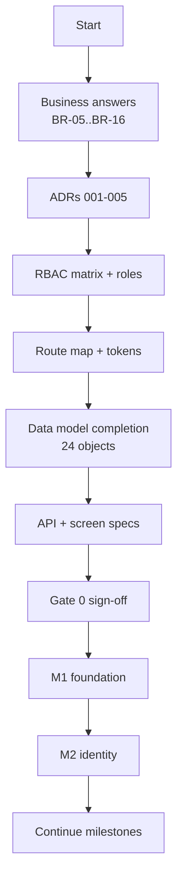

# Readiness Checklist

> [!danger] Current verdict: NOT READY
> **Documentation:** planning-complete with defined gaps.
> **Implementation:** zero lines of application code.
> **Production:** explicitly not ready.
> Only G0-03, G0-05, G0-06 and G0-24 are checked, each with linked evidence (4 of 35). Every other checkbox remains unchecked. The approved Foundation Development Gate is ACTIVE for M1-T01, and separate task-specific exceptions are EFFECTIVE for M1-T02 (Foundation Development Gate §11) and M1-T03 (§12); M1-T01, M1-T02 and M1-T03 are IMPLEMENTED pending independent review. Full Gate 0 remains NOT READY. Checking a box requires linked evidence, not intent.

## Related documents
- [[00-START-HERE]]
- [[01-Product/Business-Rules]]
- [[01-Product/Decision-Register]]
- [[05-Architecture/Architecture-and-Interfaces]]
- [[05-Architecture/Data-Model]]
- [[05-Architecture/API-Contracts]]
- [[05-Architecture/Events-and-Failures]]
- [[06-Implementation/Backlog]]
- [[08-Operations/Decisions-to-Confirm]]
- [[09-Implementation/Architecture-Audit]]
- [[09-Implementation/Dependency-Graph]]
- [[09-Implementation/Milestones]]
- [[09-Implementation/Task-Backlog]]

---

## 0. How to use this checklist

- **Gate 0** must be fully green before implementation, except that approved Foundation Development Gate Revision 1 may authorize M1-T01 alone after all of its activation prerequisites are verified, and the separate §11 and §12 exceptions authorize M1-T02 and M1-T03 respectively. These exceptions do not change Gate 0 status or authorize any other task.
- Each later gate maps to a milestone in [[09-Implementation/Milestones]].
- A box may only be checked when the evidence column has a link to a test run, document, or PR.
- Partial completion is recorded as partial, never as complete.

---

## 1. Gate 0 — Decisions and specifications

### 1.1 Architecture decisions

| # | Requirement | Evidence | Status |
|---|---|---|---|
| G0-01 | ADR-001 authentication architecture approved | — | ☐ |
| G0-02 | ADR-002 ORM selected with decision matrix | — | ☐ |
| G0-03 | ADR-003 deployment topology approved | [[05-Architecture/ADRs/ADR-003-Application-and-Deployment-Topology]] Revision 1; Project Owner approval 2026-10-19; [[05-Architecture/ADRs/Decision-Log]] | ☑ |
| G0-04 | ADR-004 money and rounding policy approved | — | ☐ |
| G0-05 | ADR-005 module boundaries approved | [[05-Architecture/ADRs/ADR-005-Module-Boundaries]] Revision 3; Project Owner approval 2026-10-19; [[06-Implementation/PROGRESS-LOG#M0-T05 approval evidence]] | ☑ |
| G0-06 | ADR index and decision log created | [[05-Architecture/ADRs/ADR-Index]] and [[05-Architecture/ADRs/Decision-Log]]; M0-T12 VERIFIED and accepted/DONE 2026-10-19; [[06-Implementation/PROGRESS-LOG#ADR-003-and-M0-T12-approval-evidence]] | ☑ |

### 1.2 Business decisions

| # | Requirement | Evidence | Status |
|---|---|---|---|
| G0-07 | Primary operating country and seller-of-record decided (BR-10) | — | ☐ |
| G0-08 | Tax-inclusive vs tax-exclusive per market decided (BR-13) | — | ☐ |
| G0-09 | Commission rounding policy decided (BR-14) | — | ☐ |
| G0-10 | COD remittance responsibility decided (BR-09) | — | ☐ |
| G0-11 | Payout cadence and minimum threshold decided (BR-07, BR-08) | — | ☐ |
| G0-12 | Returns window and payout hold decided (BR-07) | — | ☐ |
| G0-13 | Negative vendor payable policy decided (BR-15) | — | ☐ |
| G0-14 | Inbound vendor→warehouse freight responsibility decided (BR-05) | — | ☐ |
| G0-15 | Customer-paid shipping policy decided (BR-11) | — | ☐ |
| G0-16 | Payment gateway availability per country verified (BR-16) | — | ☐ |
| G0-17 | Failed delivery / RTO liability decided (BR-06) | — | ☐ |
| G0-18 | Default locale, fallback, and translation review policy decided | — | ☐ |
| G0-19 | Recommendation privacy and consent policy decided (privacy policy ID pending; BR-10 in Decision-Register is country/seller-of-record) | — | ☐ |

### 1.3 Specifications

| # | Requirement | Evidence | Status |
|---|---|---|---|
| G0-20 | RBAC permission matrix published (role × permission × scope) | — | ☐ |
| G0-21 | Role vocabulary conflicts resolved (C-08) | — | ☐ |
| G0-22 | Canonical route map published (C-11) | — | ☐ |
| G0-23 | Single design token set published (C-10) | — | ☐ |
| G0-24 | App topology decided: finance app vs admin route (C-09) | [[05-Architecture/ADRs/ADR-003-Application-and-Deployment-Topology]] Revision 1 places protected Finance inside Admin; Project Owner approved 2026-10-19 | ☑ |
| G0-25 | Missing data objects designed (24 items, audit §3.1) | — | ☐ |
| G0-26 | Missing API areas specified (18 items, audit §6.1) | — | ☐ |
| G0-27 | Missing screens specified (22 items, audit §7) | — | ☐ |
| G0-28 | Field-level spec complete for all 22 existing screens | — | ☐ |
| G0-29 | Performance budgets and capacity targets published | — | ☐ |
| G0-30 | PII classification and retention policy published | — | ☐ |
| G0-31 | Accessibility conformance target declared (e.g. WCAG 2.2 AA) | — | ☐ |
| G0-32 | Error code catalog published | — | ☐ |
| G0-33 | Status enum catalog published per resource | — | ☐ |
| G0-34 | Webhook contract per provider published | — | ☐ |
| G0-35 | Idempotency semantics published (scope, TTL, replay) | — | ☐ |

**Gate 0 exit:** all items checked with evidence. **Currently 4/35 (G0-03, G0-05, G0-06 and G0-24); 31 outstanding. Gate 0 remains NOT READY.**

---

## 2. Gate 1 — Foundation, identity, orders, ledger

### 2.1 Foundation

| # | Requirement | Evidence | Status |
|---|---|---|---|
| G1-01 | Monorepo builds on clean clone | — | ☐ |
| G1-02 | CI green: lint, typecheck, unit, migration, build | — | ☐ |
| G1-03 | Local Docker stack runs (Postgres, Redis, Meilisearch, MinIO) | — | ☐ |
| G1-04 | Forward-only migration policy documented and tested | — | ☐ |
| G1-05 | Outbox dispatcher exactly-once verified | — | ☐ |
| G1-06 | Inbox dedupe verified | — | ☐ |
| G1-07 | Idempotency replay verified | — | ☐ |
| G1-08 | Audit log append-only verified | — | ☐ |
| G1-09 | Money value object tested (JPY, rounding, currency guard) | — | ☐ |
| G1-10 | Structured logging with redaction verified | — | ☐ |

### 2.2 Identity and isolation

| # | Requirement | Evidence | Status |
|---|---|---|---|
| G1-11 | Customer auth lifecycle tested | — | ☐ |
| G1-12 | MFA enforced for privileged roles | — | ☐ |
| G1-13 | Vendor membership isolation proven by API test | — | ☐ |
| G1-14 | Customer order isolation proven by API test | — | ☐ |
| G1-15 | Guest order access requires verified token | — | ☐ |
| G1-16 | Every endpoint has a permission matrix entry | — | ☐ |
| G1-17 | Rate limiting active on auth/OTP | — | ☐ |

### 2.3 Commerce and money

| # | Requirement | Evidence | Status |
|---|---|---|---|
| G1-18 | One checkout → one parent + N vendor orders verified | — | ☐ |
| G1-19 | Place-order idempotency verified | — | ☐ |
| G1-20 | Price snapshot immutability verified | — | ☐ |
| G1-21 | Ledger balances per transaction and currency | — | ☐ |
| G1-22 | ¥1,000 → ¥100 commission → ¥900 vendor share verified | — | ☐ |
| G1-23 | Commission on post-discount price verified | — | ☐ |
| G1-24 | Duplicate webhook does not double-post | — | ☐ |
| G1-25 | Unknown provider state → REVIEW, no duplicate charge | — | ☐ |
| G1-26 | Ledger append-only enforced | — | ☐ |

**Gate 1 exit:** 0/26.

---

## 3. Gate 2 — Inventory, fulfillment, shipping

| # | Requirement | Evidence | Status |
|---|---|---|---|
| G2-01 | Concurrent checkout cannot oversell | — | ☐ |
| G2-02 | Reservation expiry releases stock idempotently | — | ☐ |
| G2-03 | Transit stock excluded from availability | — | ☐ |
| G2-04 | Duplicate receipt does not double-add stock | — | ☐ |
| G2-05 | Quarantined/damaged never sellable | — | ☐ |
| G2-06 | Cross-vendor stock isolation proven | — | ☐ |
| G2-07 | Stock adjustment audited with reason | — | ☐ |
| G2-08 | Shipment lifecycle tested end-to-end | — | ☐ |
| G2-09 | Vendor-fulfilled → zero platform delivery deduction | — | ☐ |
| G2-10 | Shared ¥300 cost allocates exactly ¥300 | — | ☐ |
| G2-11 | Late carrier invoice produces adjustment, not replacement | — | ☐ |
| G2-12 | Dispatch impossible without reservation | — | ☐ |
| G2-13 | Lost/failed shipment recovery tested | — | ☐ |

**Gate 2 exit:** 0/13.

---

## 4. Gate 3 — Tax, COD, settlement, payout

| # | Requirement | Evidence | Status |
|---|---|---|---|
| G3-01 | Tax quote versioned and expiring | — | ☐ |
| G3-02 | Issued invoice immutable after rate change | — | ☐ |
| G3-03 | Credit note links refund + original invoice | — | ☐ |
| G3-04 | Customer cannot access another customer's invoice | — | ☐ |
| G3-05 | COD delivered ≠ collected ≠ remitted ≠ matched | — | ☐ |
| G3-06 | Delivered but unremitted remains payout-held | — | ☐ |
| G3-07 | Short remittance creates discrepancy | — | ☐ |
| G3-08 | Overpayment never silently reallocated | — | ☐ |
| G3-09 | Vendor COD disabled until admin approval | — | ☐ |
| G3-10 | Per-offer COD toggle only for approved vendors | — | ☐ |
| G3-11 | Settlement statement reconciles to ledger | — | ☐ |
| G3-12 | Payout never exceeds cleared liability | — | ☐ |
| G3-13 | Maker ≠ approver enforced | — | ☐ |
| G3-14 | Provider timeout → REVIEW, no second transfer | — | ☐ |
| G3-15 | Duplicate `OrderDelivered`/`CODRemitted` cannot pay twice | — | ☐ |
| G3-16 | Negative balance held, not auto-debited | — | ☐ |
| G3-17 | Refund after payout creates recovery receivable | — | ☐ |

**Gate 3 exit:** 0/17.

---

## 5. Gate 4 — Returns, localization, search, growth

| # | Requirement | Evidence | Status |
|---|---|---|---|
| G4-01 | Partial cancellation preserves unaffected vendor orders | — | ☐ |
| G4-02 | Duplicate cancellation issues no double refund | — | ☐ |
| G4-03 | Refund cap by eligible quantity enforced | — | ☐ |
| G4-04 | Return inspection → disposition → refund tested | — | ☐ |
| G4-05 | Every compensation links to a ledger transaction | — | ☐ |
| G4-06 | Locale switch preserves cart and order context | — | ☐ |
| G4-07 | One canonical product appears once in search | — | ☐ |
| G4-08 | Cross-language query resolves via aliases | — | ☐ |
| G4-09 | Unapproved/out-of-stock excluded from search | — | ☐ |
| G4-10 | Index staleness visible to admin | — | ☐ |
| G4-11 | Critical emails deduped, localized, correctly addressed | — | ☐ |
| G4-12 | Catalog sync does not create paid campaigns | — | ☐ |
| G4-13 | Promo start/end reflected in catalog status | — | ☐ |
| G4-14 | Suspended/out-of-stock excluded from recommendations | — | ☐ |
| G4-15 | No vendor billed for advertising in ledger | — | ☐ |
| G4-16 | Meta browser/server events deduplicate | — | ☐ |
| G4-17 | No provider secrets in client bundle | — | ☐ |

**Gate 4 exit:** 0/17.

---

## 6. Launch readiness

### 6.1 Security

| # | Requirement | Evidence | Status |
|---|---|---|---|
| L-01 | OWASP review complete; no critical/high open | — | ☐ |
| L-02 | Dependency audit clean or accepted | — | ☐ |
| L-03 | Full authorization matrix regression green | — | ☐ |
| L-04 | Secrets in managed store; none in repo or logs | — | ☐ |
| L-05 | CSRF and cookie settings verified | — | ☐ |
| L-06 | Upload malware scanning active | — | ☐ |
| L-07 | Webhook signatures verified for all providers | — | ☐ |
| L-08 | Rate limits tuned and documented | — | ☐ |

### 6.2 Reliability

| # | Requirement | Evidence | Status |
|---|---|---|---|
| L-09 | Backup restore drill meets RPO/RTO | — | ☐ |
| L-10 | Outbox age and queue lag dashboards live | — | ☐ |
| L-11 | Unreconciled money alert live | — | ☐ |
| L-12 | Stock discrepancy alert live | — | ☐ |
| L-13 | Runbooks for each documented failure mode | — | ☐ |
| L-14 | Incident response and on-call defined | — | ☐ |
| L-15 | Load test meets documented budgets | — | ☐ |

### 6.3 Compliance and operations

| # | Requirement | Evidence | Status |
|---|---|---|---|
| L-16 | Legal/accounting review of tax and seller-of-record | — | ☐ |
| L-17 | Seller agreement and payout permissions reviewed | — | ☐ |
| L-18 | Data privacy and retention reviewed | — | ☐ |
| L-19 | Carrier and COD contracts in place | — | ☐ |
| L-20 | Payment gateway contracts in place | — | ☐ |
| L-21 | Support escalation and SLA defined | — | ☐ |
| L-22 | Feature flags enable staged rollout | — | ☐ |
| L-23 | Launch sign-off recorded with owner and date | — | ☐ |

**Launch exit:** 0/23.

---

## 7. Overall readiness score

| Area | Items | Checked | Status |
|---|---|---|---|
| Gate 0 — Decisions and specs | 35 | 4 | ❌ |
| Gate 1 — Foundation, identity, orders, ledger | 26 | 0 | ❌ |
| Gate 2 — Inventory, fulfillment, shipping | 13 | 0 | ❌ |
| Gate 3 — Tax, COD, settlement, payout | 17 | 0 | ❌ |
| Gate 4 — Returns, i18n, search, growth | 17 | 0 | ❌ |
| Launch readiness | 23 | 0 | ❌ |
| **Total** | **131** | **4** | **3.1%** |

---

## 8. Unblock sequence (recommended)

**Immediate next actions, in order:**

1. Resolve the nine business questions in [[08-Operations/Decisions-to-Confirm]].
2. Write ADR-002 (ORM) and ADR-001 (auth) — these block all scaffolding.
3. Publish the RBAC matrix and reconcile role names.
4. Reconcile design tokens and the canonical route map.
5. Complete the missing data objects, prioritizing identity, cart, discounts, translations, media, and COD approval.
6. Sign off Gate 0 before general M1 work. M1-T01, M1-T02 and M1-T03 alone may proceed only under their narrowly approved Foundation Development Gate exceptions and recorded handoff/execution approvals.

**Do not start implementation before Gate 0 sign-off, except M1-T01 (activated Foundation Development Gate), M1-T02 (§11 exception) and M1-T03 (§12 exception).** Doing other work would require guessing unresolved rules, which `AGENTS.md` §4 forbids.

## Gate 0 status after documentation reconciliation

**NOT READY:** G0-03 (approved ADR-003 topology), G0-05 (approved ADR-005 boundaries), G0-06 (accepted ADR index/log) and G0-24 (finance placement) are satisfied (4/35); 31 requirements remain outstanding. The approved Foundation Development Gate is **ACTIVE for M1-T01** and the §11 and §12 exceptions are EFFECTIVE for **M1-T02** and **M1-T03** respectively; none completes Gate 0. Review [[09-Implementation/Milestone-Reconciliation]], [[09-Implementation/Task-Status-Policy]], [[05-Architecture/ADRs/ADR-005-Module-Boundaries]], and [[09-Implementation/Feature-Coverage-Gaps]].
